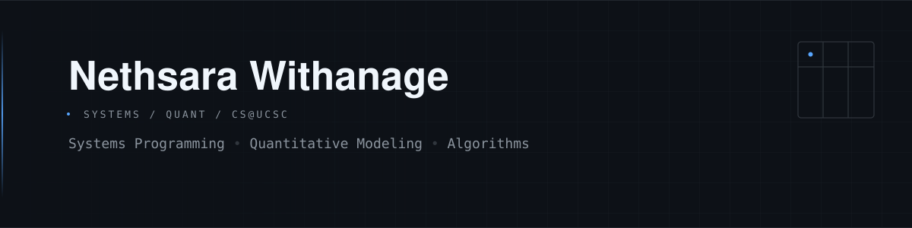

  

 

### About

Computer Science undergraduate at the University of Colombo School of Computing (UCSC), working at the layer where software meets hardware and where models meet markets. Most comfortable reading a man page or a scheduler trace, equally comfortable backtesting a portfolio model in Python.

- **Systems** — memory management, process scheduling, and IPC in C on Linux; built from the primitives up, not from a framework down.
- **Distributed systems** — microservice architectures applying classic GoF design patterns to real coordination problems (enrollment, messaging, state).
- **Quantitative modeling** — risk simulation and portfolio optimization, treating markets as systems with the same discipline applied to kernels.

 

### Featured Engineering Work

**[StatQuant Risk Simulator](https://github.com/Nethsara-Withanage)**
Quantitative risk modeling and portfolio optimization engine — Monte Carlo simulation, VaR/CVaR estimation, and efficient-frontier optimization surfaced through an interactive Streamlit interface.
`Python` `NumPy/Pandas` `Streamlit`

**[NexusEnroll](https://github.com/Nethsara-Withanage)**
Microservices architecture for university course enrollment, structured around GoF design patterns (Strategy, Observer, Factory) for extensible scheduling, notification, and enrollment workflows. Services communicate asynchronously over RabbitMQ and run containerized end-to-end.
`Java` `Spring Boot` `React` `RabbitMQ` `Docker`

**[Linux Systems Suite](https://github.com/Nethsara-Withanage)**
A set of from-scratch C systems projects: a custom heap allocator (`MyMalloc` / `MyFree`) built on raw `sbrk`/`mmap`, a 4-queue multilevel feedback scheduler (MLQ) for CPU scheduling, and process trees communicating via pipes and signals.
`C` `Linux` `POSIX`

 

### Tech Stack

**Systems**

  
  
  
  
  

**Backend / Web**

  
  
  
  
  

**Data / Math**

  
  
  
  
  

 

### Connect

  
  

